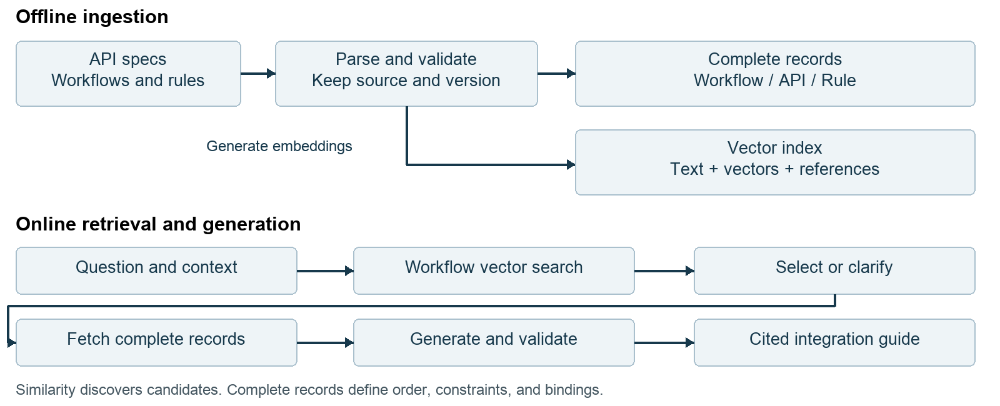

# API Integration Assistant Technical Proposal

The proposed assistant helps API consumers turn a business goal into an integration guide. It identifies the applicable workflow, explains the required API sequence, selects scenario-relevant attributes, identifies where values come from, and supplies examples with references to the underlying specifications and rules.

The recommended first implementation uses LangChain to coordinate a fixed retrieval and generation pipeline. Actual embeddings and vector retrieval are required in the first prototype. Semantic search discovers candidate workflows; exact lookups retrieve their complete definitions, API contracts, and linked rules. This document describes the proposed implementation, not an implemented system. All example APIs and business rules are fictional and do not represent BNY systems.

## 1 Purpose and architecture

### Intended user experience

A developer asks: “I want to open a USD account for a new individual customer. Which APIs should I call, and what should I send?” The assistant returns the applicable workflow and its conditions; an ordered list of operations; required, conditional, optional, and inapplicable fields; value sources and response-to-request mappings; example requests; and specific source references.

For the demonstration, the answer explains how to create a customer, verify identity, and create an account. It shows how customerId and verificationId pass between operations, and why personal details apply while company registration details do not. The current scope is integration guidance. Mock execution can be added if required; live banking transactions are outside this prototype's default scope.

### Workflow and scenario

A workflow defines how to achieve a business outcome: steps, order, prerequisites, branches, and data dependencies. A scenario describes the conditions under which that outcome is needed. Several scenarios can share one branching workflow, or be represented by separate workflows. There is no universal one-to-one relationship.

The prototype defines two workflows, open_personal_account and open_business_account, to make selection observable. They share three operations but differ in attribute applicability and verification type. Both cover new customers only. The real workflow structure should follow the supplied business definitions.



Ingestion prepares and indexes knowledge before questions arrive. The online retrieval augmented generation pipeline retrieves relevant evidence and uses it to produce an answer. The LLM interprets language and explains evidence. Application code controls lookups, versions, validation, and failure handling. Approved workflow definitions determine API order.

## 2 Knowledge and storage model

### Complete records and the vector index

An embedding represents text numerically for similarity search. A vector record must also carry searchable text or a reference to it, plus metadata linking to complete knowledge. The vector itself cannot reconstruct an API contract. The prototype can store original sources and canonical records in JSON/YAML files, and maintain a local persistent Chroma index through LangChain. This is a prototype choice; enterprise storage remains to be agreed. [LangChain Chroma integration](https://docs.langchain.com/oss/python/integrations/vectorstores/chroma)

| Record | Essential contents | Use during a question |
| --- | --- | --- |
| Original source | Specification, workflow, rules, source revision and location | Evidence and reprocessing |
| Workflow | ID, version, purpose, applicability, ordered steps, branches, operation and rule references, bindings | Complete integration plan |
| API operation | API ID, spec version, operationId, method/path, parameters, request/response schemas, shared definitions, authentication requirements | Contract and example constraints |
| Business rule | ID, version, scope, conditions, constraints, exceptions, source, executable-check status | Scenario requirements |
| Vector record | Searchable text, embedding, document type, canonical reference, bundle and source metadata | Candidate discovery |

These are logical responsibilities, not a requirement to deploy several databases. A project directory and a local vector index are sufficient for the small demonstration.

### Linking a vector hit to complete knowledge

The following abbreviated vector record omits the numerical embedding:

```yaml
text: "Open an account for a new individual customer"
metadata:
  document_type: workflow
  workflow_id: open_personal_account
  workflow_version: "1.0"
  bundle_id: demo-v1
  source_ref: workflows/personal.yaml
```

After retrieving this record, code calls get_workflow with its workflow ID, version, and bundle. The complete workflow references customer-api / v1 / createCustomer and the other required operations. Code follows those references to fetch full contracts and rules, rather than reconstructing them from search snippets.

Use API ID, specification version, and operationId together as an operation key. operationId alone is not globally unique across APIs and versions. Workflow version, API version, source revision, and index batch are also distinct. A bundle_id identifies a validated set of mutually compatible records and its index, allowing one answer to use a consistent snapshot.

## 3 Ingestion pipeline

### Parse and validate the inputs

Load OpenAPI specifications, supplied workflows, business rules, and approved examples. Preserve source locations and revisions. Parse methods, paths, operation IDs, parameter locations, request/response schemas, required properties, enums, formats, and authentication requirements. Resolve needed schema references while retaining a reference graph for recursive definitions. Unresolved references must produce an ingestion error. [OpenAPI 3.1.1 specification](https://spec.openapis.org/oas/v3.1.1.html)

Normalize workflows and rules into consistent records. A workflow owner must confirm ordering, branches, applicability, and bindings. If only prose exists, an LLM may propose a draft registry entry for review. The prototype uses manually authored workflow definitions so uncertain inference does not determine execution order.

Check that every referenced operation and rule exists in the selected version set; input and output paths are valid; and constraints are consistent. Retain source locators such as file path, operationId, schema JSON Pointer, or rule section. Do not activate a bundle with broken references or contradictory mandatory constraints.

### Prepare retrieval units

Chunking should preserve the meaning of each knowledge unit rather than splitting every source at arbitrary character boundaries.

| Type | Retrieval unit | Context retained with each unit |
| --- | --- | --- |
| Workflow | A compact description of one complete scenario or workflow | Goal, applicability, exclusions, example questions, ID |
| API | Documentation for one operation | API identity, purpose, parameters, schema references, version |
| Rule | One complete rule | Condition, consequence, exceptions, scope, rule ID |

Long descriptions may need smaller chunks, but each chunk retains a canonical reference. A rule's condition and consequence must remain connected. Index workflow descriptions, API documentation, and rule text in the first prototype. Workflow records support initial discovery; API and rule passages support optional explanatory retrieval after a workflow has been selected. Required contracts and rules still come from exact linked reads.

### Embed and publish a consistent bundle

Generate an embedding for each retrieval unit and write the vector, text, and metadata to the index. Record the embedding model and relevant configuration. Queries must use a compatible embedding model; incompatible model changes require reindexing.

On updates, build and validate a new set of complete records and corresponding index before changing the active bundle. Pin each answer to that bundle. Remove obsolete records from the active search scope and retain prior bundles when needed for traceability. Full rebuilding is acceptable for the small prototype; incremental synchronization can follow when source volume requires it.

## 4 Online retrieval and answer generation

### Discover and select a workflow

1. Prepare the query from the current message and relevant conversation context. If the user first asks about account opening and then replies “business,” retain the account-opening intent. New versus existing customer status still needs evidence or clarification; do not invent it. New corrections replace earlier assumptions.
2. Embed that query and perform actual vector search, filtering document_type to workflow and pinning the active bundle. Apply hard scenario filters only for known conditions; do not assume personal or business when unspecified.
3. Return top-k candidate IDs, versions, descriptions, applicability, sources, and retrieval scores. With two workflows, k can include both. Tune k with a larger dataset later. A similarity score is a retrieval signal, not proof of eligibility.
4. Ask the LLM for a constrained decision: matched, needs_clarification, or unsupported. A match names a retrieved candidate; clarification identifies a missing condition that changes selection. Structured output helps application code consume this decision, but does not establish its correctness. [LangChain structured output](https://docs.langchain.com/oss/python/langchain/structured-output)
5. Validate the decision in code. The ID must belong to the returned candidates, resolve to an existing record and version, and satisfy known conditions. Reject invalid IDs and contradictory selections.

“Open an account” requires clarification about customer type. “Open a USD account for a new business customer” can select the business workflow. An unsupported transfer request may still have nearest neighbors in the index; the selector must not force it into an account-opening workflow.

### Retrieve all required evidence

Fetch the complete selected workflow, including all steps, branches, prerequisites, and bindings. For each step, fetch its operation contract using the compound operation key. Retrieve rules explicitly linked from the workflow, its operations, and the applicable shared rules declared in the bundle. Evaluate applicability against known scenario conditions and retain provenance.

Required rules must not depend on top-k semantic recall. Optional supplemental search can explain terminology or locate supporting text within the selected workflow's linked, version-consistent material. The small prototype can fit the full evidence package into context. At larger scale, generate per step with complete local evidence rather than truncating mandatory constraints.

### Resolve attributes and validate examples

Combine the API contract and scenario rules to distinguish required, conditional, optional, and inapplicable fields. Identify whether each value comes from user business data, an allowed enum, environment configuration, or a previous response. Scenario instructions cannot silently override a schema requirement; conflicting sources produce a data error.

A request for examples does not normally require real customer information. Use clearly labeled synthetic values or placeholders. Missing customer type may block workflow selection; missing a real customer name usually does not block an illustrative guide.

Generate the explanation and structured example requests from the evidence. Validate schemas, enums, field paths, cross-step bindings, and encoded business constraints. Check that citations resolve to records actually loaded. A bounded repair attempt may receive validation errors; if it still fails, report the problem rather than mark the example valid. Passing schema validation neither executes an API nor proves that a live service will accept the request.

| Result | Condition | User-facing behavior |
| --- | --- | --- |
| matched | Applicable workflow and complete evidence | Cited integration guide |
| needs_clarification | Missing selection-critical condition | A specific clarification question |
| unsupported | No candidate covers the known goal | State the gap in available knowledge |
| data_error | Broken reference, version mismatch, or conflicting constraints | Explain the knowledge problem and stop affected generation |

The first three are selection outcomes. data_error is an application result and must not be disguised as an unsupported customer request.

## 5 Worked account opening example

### Shared operations and scenario differences

Both demonstration workflows use version 1.0 and bundle demo-v1. The following fictional gate permits account creation only after identity verification returns PASSED. Other verification outcomes require separate handling outside this simplified workflow.

| Step | Operation and endpoint | Main input and output |
| --- | --- | --- |
| 1 Create customer | customer-api / v1 / createCustomer; POST /customers | Customer type and applicable details; returns customerId |
| 2 Verify identity | identity-api / v1 / verifyIdentity; POST /identity-verifications | customerId and verificationType; returns verificationId and status |
| 3 Create account | account-api / v1 / createAccount; POST /accounts | customerId, verificationId, currency; returns accountId |

| Requirement | open_personal_account | open_business_account |
| --- | --- | --- |
| customerType | PERSONAL | BUSINESS |
| Customer details | fullName required | legalName and companyRegistrationNumber required |
| verificationType | PERSON_ID | COMPANY_REGISTRATION |
| currency | User selects USD or EUR | User selects USD or EUR |

The dummy OpenAPI should encode compatible conditional schemas, for example oneOf branches for personal and business customer requests. Sharing an operation does not mean every property applies to every workflow.

### Selection and registry lookup

The user requests a USD account for a new individual customer. Search retrieves candidates; applicability checks select open_personal_account. Code resolves the selected workflow and its operation references. The abbreviated registry below illustrates the essential links, rather than a complete executable configuration:

```yaml
workflow_id: open_personal_account
workflow_version: "1.0"
bundle_id: demo-v1
steps:
  - id: customer
    operation_ref: customer-api/v1/createCustomer
  - id: verification
    operation_ref: identity-api/v1/verifyIdentity
    bindings:
      customerId: customer.response.customerId
  - id: account
    operation_ref: account-api/v1/createAccount
    requires: verification.response.status == PASSED
    bindings:
      customerId: customer.response.customerId
      verificationId: verification.response.verificationId
rule_refs:
  - personal-customer/1.0
  - verification-gate/1.0
```

### Example requests and value provenance

First, POST /customers. PERSONAL comes from the confirmed scenario; Alex Example is synthetic and would be replaced with customer data supplied by the integrating application.

```json
{"customerType": "PERSONAL", "fullName": "Alex Example"}
```

Assume a mock response of {"customerId": "cus_demo_001"}. Second, POST /identity-verifications uses that returned ID. PERSON_ID comes from the personal workflow rule.

```json
{"customerId": "cus_demo_001", "verificationType": "PERSON_ID"}
```

Assume a mock response of {"verificationId": "ver_demo_001", "status": "PASSED"}. Once the gate is satisfied, POST /accounts uses both preceding IDs. USD comes from the user's request and is allowed by the dummy contract.

```json
{
  "customerId": "cus_demo_001",
  "verificationId": "ver_demo_001",
  "currency": "USD"
}
```

These are request-body illustrations with assumed responses, not executed calls. Actual integration also requires server configuration, authentication, and headers from the specification. Bindings must preserve returned IDs across steps. If verification returns FAILED, the guide must not authorize proceeding to step three.

An answer could begin: “Use personal account opening version 1.0. Call createCustomer, then verifyIdentity, then createAccount after a PASSED result. Reuse the customerId from step one and verificationId from step two. fullName applies to this scenario; company registration details do not. Names and response IDs below are synthetic.” Attach references to the relevant workflow steps, request schema locations, and verification-gate rule, including versions.

## 6 Implementation and validation

### Prototype components

| Component | Proposed implementation | Responsibility |
| --- | --- | --- |
| Complete knowledge | JSON/YAML files with stable references | Workflows, operations, rules, version bundles |
| Semantic retrieval | LangChain embedding interface and local Chroma | Indexing, candidate retrieval, metadata filters |
| Model processing | Approved model with structured output | Candidate assessment, clarification, explanation |
| Orchestration | Fixed Python sequence and lookup functions | Ordering, exact reads, failure handling |
| Validation | Schema validator and explicit rule checks | Payloads, bindings, encoded constraints |
| Chat interface | Minimal Streamlit page | Input, answers, separate diagnostic trace |

LangChain supplies integration interfaces; application code still implements knowledge reads and domain validation. Streamlit chat_input and chat_message can support a minimal interface. [Streamlit chat elements](https://docs.streamlit.io/develop/api-reference/chat)

The following pseudocode describes responsibilities, not runnable code:

```text
bundle = pin_active_bundle()
context = prepare_query(message, conversation)
candidates = search_workflows(context, bundle)
decision = select_or_clarify(context, candidates)
validate_selection(decision, candidates)
if decision.status != matched: return decision
workflow = get_workflow(decision.id, decision.version, bundle)
evidence = load_operations_and_all_applicable_rules(workflow)
plan = resolve_steps_fields_and_bindings(workflow, evidence)
draft = generate_guide(context, plan, evidence)
return validate_examples_and_attach_sources(draft, evidence)
```

### Tools and MCP

search_workflows, get_workflow, and get_api_spec can later be exposed as tools. Tool descriptions tell a model which capabilities exist; the underlying functions perform retrieval and reads. MCP can expose these capabilities to multiple clients through a common protocol. It does not supply the workflow matching algorithm. [LangChain tools](https://docs.langchain.com/oss/python/langchain/tools); [MCP architecture](https://modelcontextprotocol.io/docs/learn/architecture)

A fixed chain is recommended first so vector retrieval always occurs and each stage is observable. The same functions can become tools or an MCP server later. Passing the entire small catalog directly into a prompt could be a baseline experiment, but does not satisfy the requirement to demonstrate vector retrieval.

### Evaluation and diagnostic visibility

Expose the prepared query, retrieved IDs and ranks, versions, selected workflow, loaded evidence references, and validation results in a developer trace. Scores must come from real execution; this proposal does not assume measured accuracy. End users receive guidance and sources rather than orchestration details.

| Test or injected failure | Expected behavior |
| --- | --- |
| Personal and business requests with paraphrases | Correct workflow, attributes, verification type |
| Ambiguous opening request followed by “business” | Clarification followed by contextual selection |
| Transfer request outside the dataset | unsupported without an invented workflow |
| Model selects an ID outside the candidates | Code rejects the decision |
| Missing operation or rule; mixed versions | data_error with the damaged reference |
| Invalid enum, missing required field, inconsistent ID | Example validation fails |
| Verification status other than PASSED | Account-creation step remains blocked |
| Updated sources and index | Consistent active bundle and traceable evidence |

Measure candidate recall separately from final selection, field applicability, rule coverage, example validity, and citation correctness. Two workflows demonstrate the implementation path; they do not establish enterprise-scale retrieval quality.

## 7 Delivery and decisions

### Implementation sequence and acceptance

First, author dummy specifications, two workflows, linked rules, and expected answers. Second, implement ingestion, reference checks, embeddings, and indexing. Third, implement selection, complete evidence loading, generation, and validation. Fourth, add the chat interface and run the evaluation set.

Acceptance requires visible vector retrieval, correct workflow selection, registry-defined sequence, complete required evidence, clear value sources, valid example structures, and distinct handling of ambiguity, unsupported requests, and knowledge errors. Each stage should produce inspectable artifacts and traces.

### Items to confirm before using enterprise data

The available requirements are sufficient to start the dummy prototype. Before connecting real sources, confirm the initial business scenario and authoritative documents; workflow and rule owners; version-selection policy; permitted model and embedding services; storage and deployment environment; and whether mock execution is part of acceptance. Retrieval and exact reads should receive the same enterprise access scope when permissions are introduced. The fictional prototype does not imply an existing BNY authorization design.

The practical benefit is faster discovery and interpretation of integration knowledge. It depends on source completeness and maintenance. Later evaluation can compare task completion time, answer correctness, and support requests without assuming benefits before measurement.

### Technical references

The architecture and fictional business rules are design recommendations. The following official references support the framework capabilities and contract concepts discussed above.

- [OpenAPI 3.1.1](https://spec.openapis.org/oas/v3.1.1.html): operation contracts, schemas, parameters, and references.
- [LangChain Chroma integration](https://docs.langchain.com/oss/python/integrations/vectorstores/chroma): vector-store integration and persistence.
- [LangChain structured output](https://docs.langchain.com/oss/python/langchain/structured-output): constrained model responses.
- [LangChain tools](https://docs.langchain.com/oss/python/langchain/tools): callable tool interfaces.
- [MCP architecture](https://modelcontextprotocol.io/docs/learn/architecture): client and server responsibilities.
- [Streamlit chat elements](https://docs.streamlit.io/develop/api-reference/chat): chat input and message components.
