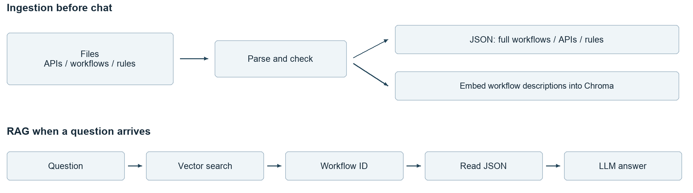

# API Integration Assistant Prototype Plan

Build a small chat assistant that turns a business request into an API integration guide. Use LangChain, two dummy workflows, and three dummy APIs. The first prototype must demonstrate real embeddings and vector search. This plan describes the proposed implementation; the APIs and business rules below are fictional.

## 1 What the user gets

Example question: “I want to open a USD account for a new individual customer. Which APIs should I call, and what should I send?”

The assistant returns the API sequence, the fields needed for that scenario, where their values come from, and sample requests. For this example, the sequence is create customer, verify identity, then create account after verification passes. The prototype provides guidance; it does not execute banking transactions.



## 2 What we ingest and store

Ingestion reads descriptions of APIs and workflows. Start with local files supplied by the team or authored as dummy data.

| Input | What it contains | Where the prototype keeps it |
| --- | --- | --- |
| OpenAPI YAML or JSON | API method, path, request and response fields, requirements | Complete records in operations.json |
| Workflow YAML or JSON | Description, applicable scenario, API sequence, data passed between steps | Complete records in workflows.json |
| Rules and checked examples | Scenario-specific fields, conditions, sample values | Complete records in rules.json |

The workflow registry is simply the collection of workflow records. A workflow can reuse APIs used by other workflows. For this demo, maintain personal and business account-opening workflows with the same three APIs but different field requirements. Both workflows cover new customers only.

The first version embeds workflow descriptions into a local Chroma vector store. Each entry includes its workflow_id. Complete API definitions and rules stay in the JSON files and are read by ID after a workflow is selected.

<!-- pagebreak -->

## 3 Ingestion pipeline

Run ingestion before the chat starts, and rerun it when the input files change. Use one fixed version of the dummy dataset and rebuild the index on updates.

1. Read the files. Parse YAML or JSON into Python objects and retain each source filename.
2. Extract API records. Read each operation's method, path, operationId, parameters, request and response schemas, required fields, allowed values, and authentication requirements. Use simple inline schemas for the dummy APIs. A YAML loader reads the file structure; our code extracts the OpenAPI fields.
3. Read workflow records and rules. The workflow file explicitly states the API sequence and data dependencies. If the team supplies only prose, turn it into a draft workflow and have the workflow owner confirm it. For the demo, write these records manually.
4. Check and save. Confirm referenced APIs and rules exist and that the named input/output fields are valid. Stop ingestion if required information is missing or contradictory. Save the complete records in local JSON files.
5. Build the vector index. Create one short search document per workflow using its description, applicability, and example questions. Generate embeddings through LangChain and save the text, vector, and workflow_id in Chroma. Use the same embedding model for later questions.

### Example workflow record

This abbreviated YAML shows the relationship between a workflow and its APIs. For this controlled demo, give all three operations unique operation IDs.

```yaml
workflow_id: open_personal_account
description: Open an account for a new individual customer
customer_type: PERSONAL
customer_status: NEW
api_sequence: [createCustomer, verifyIdentity, createAccount]
bindings:
  verifyIdentity.customerId: createCustomer.response.customerId
  createAccount.customerId: createCustomer.response.customerId
  createAccount.verificationId: verifyIdentity.response.verificationId
account_creation_requires: verifyIdentity.response.status == PASSED
rule_id: personal_account_rules
```

The workflow owner confirms the sequence, conditions, and bindings. The application then reads them from the registry. API specifications explain how to call individual APIs; the workflow definition supplies the business sequence.

For example, the personal_account_rules record requires PERSONAL, fullName, and PERSON_ID verification. The business record instead requires BUSINESS, legalName, companyRegistrationNumber, and COMPANY_REGISTRATION verification. The dummy API schemas must agree with these scenario requirements.

<!-- pagebreak -->

## 4 RAG pipeline and backend lookup

RAG retrieves stored information and gives it to the LLM to produce an answer. The backend for this prototype consists of the local JSON records and the Chroma index.

1. Read the question and relevant chat context. Capture conditions the user actually supplied, such as personal versus business and new versus existing customer.
2. Embed the question and search Chroma. Return the two closest workflow descriptions with their IDs. Show the real retrieval results in a developer trace so vector search is visible in the demo.
3. Select or clarify. Give the candidates and question to the LLM. It selects an applicable candidate or asks for missing information. Validate that the selected ID belongs to the retrieved candidates. A nearest result alone does not prove a match.
4. Read the complete workflow by ID from workflows.json. Follow its api_sequence to read each full operation from operations.json, and its rule_id to read all linked rules and examples from rules.json. These reads are ordinary application lookups.
5. Generate the guide. Give the LLM the question, complete workflow, API definitions, and rules. Ask for the call order, applicable fields, value sources, and sample requests. Attach source filenames and operation IDs.
6. Check the answer. Check sample payloads against the dummy schemas, preserve IDs passed between steps, and enforce the verification condition. If a check fails, report the problem instead of presenting the example as ready to use.

### The lookup in a few lines

The following is pseudocode. The lookup and validation functions are application code we need to implement.

```python
query = combine_question_and_chat_context(message, history)
candidates = vector_search(query, k=2)
choice = select_or_clarify(query, candidates)
if choice.needs_clarification or choice.unsupported:
    return choice.message
check_selected_id(choice.workflow_id, candidates)
workflow = workflows_by_id[choice.workflow_id]
apis = [operations_by_id[key] for key in workflow.api_sequence]
rules = rules_by_id[workflow.rule_id]
answer = generate_guide(query, workflow, apis, rules)
return check_examples_and_sources(answer, workflow, apis, rules)
```

“Open an account” needs a question about customer type and status. A request for a money transfer is unsupported by this dataset. A missing API record is a data problem. Handle these cases explicitly rather than forcing an account-opening answer.

LangChain connects the embedding model, vector store, and LLM. Our Python code handles OpenAPI parsing, registry reads, and business checks. A fixed chain is sufficient; tools or MCP can be added later if needed.

<!-- pagebreak -->

## 5 Example answer and demo checks

For a new personal customer opening a USD account, the guide uses the following fictional requests. Names and response IDs are synthetic examples; a real integration uses customer data and actual API responses. Server details and authentication come from the API specification.

### First create the customer

POST /customers. PERSONAL comes from the selected scenario; fullName comes from customer data.

```json
{"customerType": "PERSONAL", "fullName": "Alex Example"}
```

Assume the response returns customerId = cus_demo_001.

### Then verify identity

POST /identity-verifications. Reuse customerId; PERSON_ID comes from the personal workflow rule.

```json
{"customerId": "cus_demo_001", "verificationType": "PERSON_ID"}
```

Assume the response returns verificationId = ver_demo_001 and status = PASSED.

### Finally create the account

POST /accounts, only after PASSED. Reuse both IDs; USD comes from the user's request and must be allowed by the API.

```json
{"customerId": "cus_demo_001", "verificationId": "ver_demo_001",
 "currency": "USD"}
```

For a business customer, the guide uses legalName and companyRegistrationNumber in place of fullName, and COMPANY_REGISTRATION for verification. These differences come from the selected workflow rules and compatible API schemas.

### What we build first

Use Python and LangChain, local JSON files, Chroma, and a simple chat page. Prepare the three dummy API specs, two workflow records, and their rules; implement ingestion; then connect retrieval, lookup, and answer generation.

The demo should show real vector retrieval, correct personal/business selection, correct API order and field choices, valid example requests, and clarification for an ambiguous question. Also show that a missing record is reported and a failed identity check prevents the account-creation step.

Keep enterprise version management, permission integration, complex workflow branches, and live execution for a later iteration. The first review should focus on whether this small flow answers the tech lead's use case clearly.

Reference documentation: [OpenAPI](https://spec.openapis.org/oas/v3.1.1.html), [LangChain Chroma integration](https://docs.langchain.com/oss/python/integrations/vectorstores/chroma).
