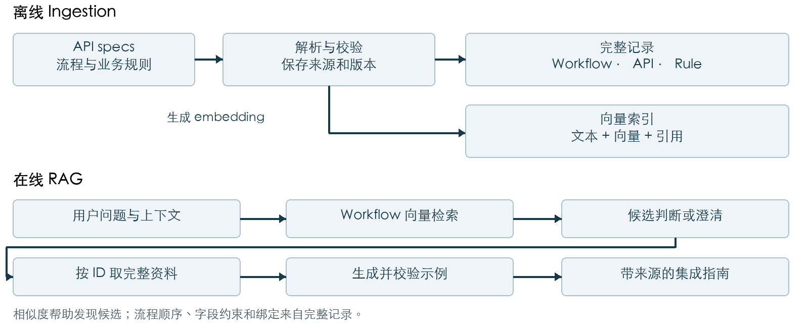

# API 接入助手详细技术方案

这份方案面向需要接入一组 API 的客户和开发者。用户用自然语言说明业务目标，助手返回适用的业务流程、API 调用顺序、当前场景需要的字段、字段值的来源，以及可供集成参考的请求示例。核心价值是减少开发者在 API 文档、业务规则和流程说明之间反复查找与手工拼接的工作。

建议第一版采用 LangChain 串联固定处理步骤：先通过真实的 embedding 和向量检索找到候选 workflow，再按明确的 ID 读取完整流程、API 契约和业务规则，最后生成并检查回答。向量检索是第一版的必需环节。本文给出待实现的设计；示例接口、字段和规则均为虚构，不代表 BNY 的真实业务或技术架构。

## 1 目标与整体架构

### 用户最终会看到什么

例如用户问：“我要为一个新个人客户开一个美元账户，需要调用哪些 API？请给我示例。”助手应说明适用的个人开户流程，列出先创建客户、再完成身份验证、最后创建账户的顺序；解释 customerId 和 verificationId 如何从前一步传给后一步；指出个人场景需要 fullName，企业注册号不适用；给出合成请求示例，并标明依据的流程、API 和规则版本。

当前交付重点是帮助用户理解并集成 API。是否另做 mock server 来实际执行示例，可以在原型范围确认时决定。真实银行接口的调用、真实账户创建和凭证管理不属于这份原型设计的默认范围。

### Workflow 和 scenario 如何理解

Workflow 是完成业务目标的流程定义，包含步骤、顺序、前置条件、分支和步骤之间的数据传递。Scenario 是这个目标发生时的具体条件，例如“新个人客户开美元账户”和“新企业客户开美元账户”。两者没有必须一对一的规则：多个 scenario 可以共用一个带分支的 workflow，也可以分别维护为多个 workflow。

为了让第一版容易演示和检查，建议维护 open_personal_account 和 open_business_account 两条 workflow。它们共用三个 API operation，但字段要求和验证类型不同。真实项目是否合并为一个带分支的流程，应由实际业务定义决定。



Ingestion 是提前整理和建立索引的过程；在线 RAG 是用户提问后检索资料并基于资料生成答案的过程。LLM 负责理解问法、判断候选是否适用和组织说明；程序负责精确读取、版本检查、约束校验和控制处理顺序。API 的先后顺序来自经过确认的 workflow registry。

## 2 后端保存什么以及怎样关联

### 向量库是检索入口

Embedding 把文本转换为便于比较语义相近程度的数值向量。Vector store 保存向量，并关联可检索文本或文本引用及 metadata。它不能从一个向量可靠地还原完整 API 契约，因此完整资料仍需保存。建议原型使用 JSON/YAML 作为完整记录，用本地 Chroma 建立向量索引；这是原型实现选择，企业环境中的具体存储产品仍待确认。[LangChain Chroma 文档](https://docs.langchain.com/oss/python/integrations/vectorstores/chroma)

| 记录类型 | 需要保存的内容 | 在问答时的用途 |
| --- | --- | --- |
| 原始资料 | OpenAPI、业务规则、workflow 源文件、修订号和来源位置 | 回溯依据和重新处理资料 |
| Workflow 完整记录 | ID、版本、描述、适用条件、步骤、分支、operation 引用、rule 引用、输入输出绑定 | 确定完整执行计划 |
| API operation 完整记录 | API 标识、spec 版本、operationId、method/path、参数、请求与响应 schema、引用定义、认证要求 | 确定接口契约及示例约束 |
| Rule 完整记录 | ID、版本、适用范围、条件、约束、例外、来源、是否已编码为校验逻辑 | 补充具体场景的业务要求 |
| Vector record | 检索文本、embedding、记录类型、完整记录引用、来源、版本集合和过滤字段 | 找到相关候选资料 |

这些是逻辑上的不同数据，不要求原型部署多套数据库。原始文件和完整记录可保存在项目目录中，向量索引保存在本地持久化目录中。

### 一个检索结果如何指向完整 workflow

下面是向量记录的简化表示，embedding 数组省略。document_type 用于区分流程、API 说明和规则说明；真正连接完整资料的是 metadata 中的稳定 ID 和版本。

```yaml
text: "新个人客户开户；先创建客户，再验证身份，最后开户"
metadata:
  document_type: workflow
  workflow_id: open_personal_account
  workflow_version: "1.0"
  bundle_id: demo-v1
  source_ref: workflows/personal.yaml
```

假设这条记录被检索出来，程序使用 get_workflow("open_personal_account", "1.0", "demo-v1") 读取完整记录。然后沿 workflow 中的 operation_refs 读取 customer-api / v1 / createCustomer 等三个 operation，沿 rule_refs 读取适用规则。无需让 LLM 从相似文本中重新拼出完整 schema。

operationId 只在相应 API 定义范围内使用，不能单独作为跨 API、跨版本的全局主键。读取 operation 应至少携带 API 标识、spec 版本和 operationId。Workflow 版本、API spec 版本、源文件修订号、索引批次也各有含义；原型用 bundle_id 指向一套验证过、能够一起使用的版本集合。

## 3 Ingestion 怎样把资料准备好

### 解析和校验源资料

第一步加载 OpenAPI、workflow 定义、业务规则及已有示例，记录来源和版本。解析 OpenAPI 时应保留 method、path、operationId、参数所在位置、请求与响应 schema、必填字段、枚举、格式及认证要求，并解析所需的 $ref。递归 schema 应保留可解析的引用图，避免无限展开；引用缺失则报告资料错误。[OpenAPI 3.1.1 规范](https://spec.openapis.org/oas/v3.1.1.html)

第二步把流程和规则整理成统一结构。业务负责人确认每条 workflow 的适用条件、步骤顺序、分支、前置条件和数据绑定。若原始资料只有自然语言，LLM 可以辅助提出结构化草稿，但顺序和业务规则需要确认后才能作为正式检索依据。原型直接手工编写两条明确的 workflow，避免把猜测当成事实。

第三步做引用一致性检查：每个 step 指向的 operation 是否存在；请求字段路径和前一步输出路径是否有效；rule_refs 是否可读取；同一版本集合内的约束是否冲突。资料无法通过检查时，不激活该批次。完整记录应保留具体来源位置，例如源文件路径、operationId、schema 的 JSON Pointer 或规则章节。

### 组织用于 embedding 的文本

不能把所有源文件随意按固定长度切开，再期待检索结果包含全部上下文。建议按资料语义组织检索单元：

| 文档类型 | 基本检索单元 | 必须一起保留的上下文 |
| --- | --- | --- |
| Workflow | 一条流程的完整简要说明 | 目标、适用条件、排除条件、示例问法、稳定 ID |
| API | 一个 operation 的说明 | API 身份、用途、参数说明、schema 引用、版本 |
| Rule | 一条完整业务规则 | 条件、约束、例外、适用范围、规则 ID |

长说明可以进一步切块，但每块都必须带回完整记录的引用。规则的条件与结论不应被拆成两个失去联系的片段。第一版为 workflow、API 和 rule 说明建立向量索引；workflow 索引用于首轮候选发现，API/rule 索引可用于选定流程后的补充解释检索。

### 建立索引和处理资料更新

为每个检索单元生成 embedding，连同文本和 metadata 写入向量库。查询时必须使用与索引兼容的 embedding 模型及配置。原型应记录模型标识和索引配置；更换不兼容的 embedding 模型时重建索引。

资料变更时，先生成新的完整记录与索引批次，验证通过后再统一切换 active bundle。一次回答固定使用同一 bundle，避免旧 workflow 读取到新 API schema。失效记录从活动查询范围移除，旧批次可保留用于追溯。原型可以全量重建这个小数据集，不必一开始就实现复杂的增量同步服务。

## 4 用户提问后如何查找并回答

### 从自然语言找到候选 workflow

1. 整理查询上下文。保留业务目标和必要的已知条件；用户上一轮问“开户”，这一轮补充“企业”，有效查询应是“企业客户开户”，而非只检索“企业”。新客户还是已有客户仍需依据上下文确认，不能自动补全。若用户更正条件，应更新上下文。
2. 生成 query embedding，并进行真实向量相似度检索。首轮限定 document_type=workflow 和当前 bundle；只对用户已明确给出的条件设置硬过滤。未说明个人或企业时，应保留两类候选。
3. 返回 top-k 候选及其 ID、版本、描述、适用条件、来源和检索分数。原型只有两条 workflow，可最多返回两条；扩大数据集后再评估 k。检索排名表示语义接近程度，不等于业务适用性证明。
4. 让 LLM 对候选做受约束的判断，输出 matched、needs_clarification 或 unsupported。matched 必须携带候选中的 workflow ID；needs_clarification 指出影响选择的缺失条件。结构化输出便于程序读取，仍需业务校验。[LangChain 结构化输出文档](https://docs.langchain.com/oss/python/langchain/structured-output)
5. 程序检查输出格式、ID 是否属于候选集、完整记录是否存在、版本是否匹配、用户已知条件是否与流程冲突。相似度最高但业务条件不符时，不能直接选中。

例如“我要开户”需要追问个人还是企业；“我要为新企业客户开美元账户”可进入企业流程。即使转账问题检索到了某条开户流程，也应判断为当前资料不支持，而不是强行给出开户指导。

### 选中之后按引用读取完整资料

读取选中 workflow 的全部步骤及条件，再按每个 operation 的复合身份读取完整契约。随后合并 workflow 引用、operation 引用和当前 bundle 中明确适用的共享规则，按适用条件筛选，并保留来源。必需规则必须通过这些显式关联取齐，不能只依赖一次 top-k 规则向量搜索。

补充语义搜索可以解释术语或找关联说明，但范围应限定在已选流程和版本关联的资料内。原型数据很小，可以把完整证据包放进模型上下文；数据扩大后应按步骤分批生成，并保证每一步所需契约与规则完整，不能通过随意截断省略必需约束。

### 确定字段和生成示例

字段要求来自 API schema 与场景规则的共同约束。程序应区分必填、条件必填、可选和不适用字段，并说明值来自用户业务数据、允许的枚举、环境配置还是前一步响应。若 API schema 已要求某字段，场景说明不能无依据地把它省略；资料互相矛盾时应报告数据错误。

“给我集成示例”通常不需要收集真实客户信息。模型可以使用明确标注的合成姓名、注册号和响应 ID，或给出待填占位符。缺失“个人还是企业”会影响流程选择，需要追问；缺失真实姓名通常不阻止提供示例。

生成后，程序校验示例请求的 schema、枚举、字段路径、跨步骤数据绑定及已经编码的业务约束，并检查引用指向实际读取的记录。失败时可把错误反馈给模型做一次受限修正；仍失败则返回问题，不把无效示例包装成可用结果。Schema 校验通过并不代表真实 API 已执行，也不保证后端业务一定接受请求。

| 处理结果 | 触发情形 | 对用户的表现 |
| --- | --- | --- |
| matched | 有适用流程且必要资料完整 | 返回带来源的集成指南 |
| needs_clarification | 缺少影响流程选择的条件 | 询问一个明确问题 |
| unsupported | 候选都不覆盖已知业务目标 | 说明当前资料未覆盖该需求 |
| data_error | 引用缺失、版本不一致或规则冲突 | 指出资料问题，停止受影响部分的生成 |

## 5 一个完整的虚构开户例子

### 两条流程共用三个 operation

以下规则仅用于演示。两条 workflow 的版本均为 1.0，使用 demo-v1 版本集合，且都只覆盖新客户。身份验证返回 PASSED 才能进入创建账户步骤；失败或其他状态的后续处理不在这个简化流程内。

| 步骤 | Operation 与接口 | 关键输入和输出 |
| --- | --- | --- |
| 1 创建客户 | customer-api / v1 / createCustomer；POST /customers | 输入客户类型及相应资料；输出 customerId |
| 2 验证身份 | identity-api / v1 / verifyIdentity；POST /identity-verifications | 输入 customerId 和 verificationType；输出 verificationId、status |
| 3 创建账户 | account-api / v1 / createAccount；POST /accounts | 输入 customerId、verificationId、currency；输出 accountId |

| 约束 | open_personal_account | open_business_account |
| --- | --- | --- |
| customerType | PERSONAL | BUSINESS |
| 客户资料字段 | fullName 必填 | legalName 和 companyRegistrationNumber 必填 |
| verificationType | PERSON_ID | COMPANY_REGISTRATION |
| currency | USD 或 EUR，由用户选择 | USD 或 EUR，由用户选择 |

Dummy OpenAPI 的条件 schema 与规则应保持一致，例如通过 oneOf 定义个人和企业的客户请求。公司字段对个人流程不适用，不应因为它出现在同一 API 的其他分支中就让个人用户填写。

### 从检索命中到具体步骤

用户问：“我要为一个新个人客户开美元账户，给我 API 顺序和请求示例。”查询明确了个人、新客户和 USD。向量检索取得候选，适用性检查选中 open_personal_account；程序验证后读取完整记录及三个 operation。下面只展示 workflow 关联结构中的关键部分，不是完整可执行配置。

```yaml
workflow_id: open_personal_account
workflow_version: "1.0"
bundle_id: demo-v1
steps:
  - id: customer
    operation_ref: customer-api/v1/createCustomer
  - id: verification
    operation_ref: identity-api/v1/verifyIdentity
    bindings:
      customerId: customer.response.customerId
  - id: account
    operation_ref: account-api/v1/createAccount
    requires: verification.response.status == PASSED
    bindings:
      customerId: customer.response.customerId
      verificationId: verification.response.verificationId
rule_refs:
  - personal-customer/1.0
  - verification-gate/1.0
```

### 请求示例与值的来源

第一步 POST /customers。PERSONAL 来自已确认场景；Alex Example 是合成姓名，真实集成时由业务系统提供。

```json
{"customerType": "PERSONAL", "fullName": "Alex Example"}
```

假设 mock 响应为 {"customerId": "cus_demo_001"}，第二步 POST /identity-verifications 使用这个响应 ID。PERSON_ID 来自个人流程规则。

```json
{"customerId": "cus_demo_001", "verificationType": "PERSON_ID"}
```

假设 mock 响应为 {"verificationId": "ver_demo_001", "status": "PASSED"}，满足流程前置条件后，第三步 POST /accounts 使用两步产生的 ID。USD 来自用户请求，并且被 dummy schema 允许。

```json
{
  "customerId": "cus_demo_001",
  "verificationId": "ver_demo_001",
  "currency": "USD"
}
```

这些是请求 body 和合成响应的说明，尚未执行。实际集成还需要依据 spec 补齐环境地址、认证和请求头。程序应检查跨步骤 ID 一致，而不能每一步随意编一个新 ID。若验证返回 FAILED，就不应建议继续执行第三步。

最终回答可以表述为：“适用流程为个人开户 1.0。按 createCustomer → verifyIdentity → createAccount 调用。第二步使用第一步返回的 customerId；只有验证状态为 PASSED，才将 customerId 与 verificationId 传给第三步。本场景需提供个人姓名，公司注册号不适用。下面的姓名与响应 ID 为合成示例。”每条步骤和关键规则旁应附来源，例如 workflows/personal.yaml 的步骤、customer API 的 request schema、verification-gate 1.0 的规则位置。

## 6 如何用 LangChain 做出首个原型

### 建议的组件与职责

| 组件 | 原型选择 | 职责 |
| --- | --- | --- |
| 完整资料 | JSON/YAML 文件及稳定引用 | 保存 workflow、operation、rule 和版本集合 |
| Embedding 与向量检索 | LangChain 接口加本地 Chroma | 索引资料，检索 workflow 候选并过滤 metadata |
| 候选判断与生成 | 获准使用的模型加结构化输出 | 判断适用性、生成澄清问题和集成说明 |
| 查询编排 | Python 固定步骤及普通读取函数 | 控制顺序、按 ID 读取、处理失败 |
| 验证器 | Schema 校验加显式规则检查 | 验证示例结构、绑定和可编码约束 |
| Chat UI | 简单 Streamlit 页面 | 接收问题、展示答案和独立调试信息 |

LangChain 提供模型、检索及工具接口；具体读取逻辑和业务校验仍需自己实现。Streamlit 的 chat_input 和 chat_message 可承载最小聊天界面。[Streamlit Chat 文档](https://docs.streamlit.io/develop/api-reference/chat)

可以先实现以下逻辑链路。它是伪代码，说明职责分界，不是可直接运行的实现：

```text
bundle = pin_active_bundle()
context = prepare_query(message, conversation)
candidates = search_workflows(context, bundle)
decision = select_or_clarify(context, candidates)
validate_selection(decision, candidates)
if decision.status != matched: return decision
workflow = get_workflow(decision.id, decision.version, bundle)
evidence = load_operations_and_all_applicable_rules(workflow)
plan = resolve_steps_fields_and_bindings(workflow, evidence)
draft = generate_guide(context, plan, evidence)
return validate_examples_and_attach_sources(draft, evidence)
```

### 目录能否包装成 tool 或 MCP

可以。search_workflows 可以是执行向量检索的工具，get_workflow 和 get_api_spec 可以是按 ID 读取完整资料的工具。工具描述告诉 LLM 有哪些能力；工具内部实现实际搜索和读取。MCP 则可以把这些能力以统一协议提供给多个客户端，它本身不是 workflow 匹配算法。[LangChain Tools 文档](https://docs.langchain.com/oss/python/langchain/tools)；[MCP 架构文档](https://modelcontextprotocol.io/docs/learn/architecture)

第一版建议由固定链路保证向量检索一定执行，并把返回候选交给 LLM 判断。这样更容易展示和排查每一步。之后可以把同样的函数暴露成 tools 或 MCP server。把小目录全部塞进 prompt 可以作为对照实验，但不满足本项目首版必须展示向量检索的要求。

### 怎样判断原型做对了

调试视图应展示规范化查询、实际候选 ID、版本、排名、选中流程、读取的 operation/rule 引用及校验结果。真实检索分数只能来自运行，方案中不编造分数或成功率。普通用户主要看到集成指导和资料来源。

| 测试输入或故障 | 预期观察结果 |
| --- | --- |
| 个人或企业开户及同义问法 | 选中对应 workflow，字段与验证类型正确 |
| 只说开户；下一轮补充企业 | 先澄清，再结合前文找到企业开户 |
| 转账等资料未覆盖需求 | 返回 unsupported，不编造流程 |
| LLM 返回候选以外的 ID | 程序拒绝该选择 |
| 缺失 operation、rule 或版本冲突 | 返回 data_error，能定位损坏引用 |
| 错误枚举、缺少必填字段、ID 不一致 | 示例校验失败，不能标为通过 |
| 验证状态不是 PASSED | 不允许继续创建账户 |
| 文档与索引更新 | 查询使用同一活动版本集合，来源可追溯 |

可以分别记录 workflow 候选召回、最终选择、字段适用性、规则覆盖、示例校验和来源正确性。两个 workflow 足以证明链路运行，但不足以证明企业规模下的检索准确率；扩大数据集后需要重新评估。

## 7 实施顺序与需要确认的事项

第一阶段准备 dummy OpenAPI、两条 workflow、关联规则和预期答案；第二阶段实现 ingestion、引用检查、embedding 和向量索引；第三阶段实现在线检索、适用性判断、完整读取、生成与验证；第四阶段接入聊天页面并运行测试集。每阶段都应能展示可检查的产物，而不只是生成一段看起来合理的回答。

原型的验收重点是：确实发生向量检索；正确定位适用 workflow；顺序来自 registry；必需契约和规则取齐；字段及值来源清楚；示例通过对应检查；模糊需求、无匹配和资料错误得到不同处理。

现有信息足够开始设计和 dummy 原型。接入真实企业资料前，需要确认首个真实业务场景、权威 spec 与规则来源、谁负责确认流程及冲突、版本选择方式、允许使用的模型和 embedding 服务、存储与部署环境，以及最终验收是否包含 mock 执行。用户可见资料的权限范围也应随企业身份上下文传入检索和精确读取；原型使用公开的虚构资料，不模拟已有 BNY 权限系统。

实际价值在于把分散的集成知识变成可追溯的指导，减少寻找相关接口、筛选字段和理解依赖的时间。效果依赖资料的完整性和维护质量。后续可以用完成典型集成任务的时间、回答准确率及人工支持次数进行衡量，不预先承诺具体收益。

### 技术参考

本文架构及 dummy 业务规则是本项目的设计建议。以下官方资料用于核实相关框架能力和接口契约概念。

- [OpenAPI 3.1.1](https://spec.openapis.org/oas/v3.1.1.html)：operation、schema、参数和引用。
- [LangChain Chroma integration](https://docs.langchain.com/oss/python/integrations/vectorstores/chroma)：向量库接入、检索和持久化。
- [LangChain Structured output](https://docs.langchain.com/oss/python/langchain/structured-output)：受约束的模型输出。
- [LangChain Tools](https://docs.langchain.com/oss/python/langchain/tools)：工具定义与调用。
- [MCP Architecture](https://modelcontextprotocol.io/docs/learn/architecture)：客户端、服务端与能力连接。
- [Streamlit Chat elements](https://docs.streamlit.io/develop/api-reference/chat)：聊天界面组件。
